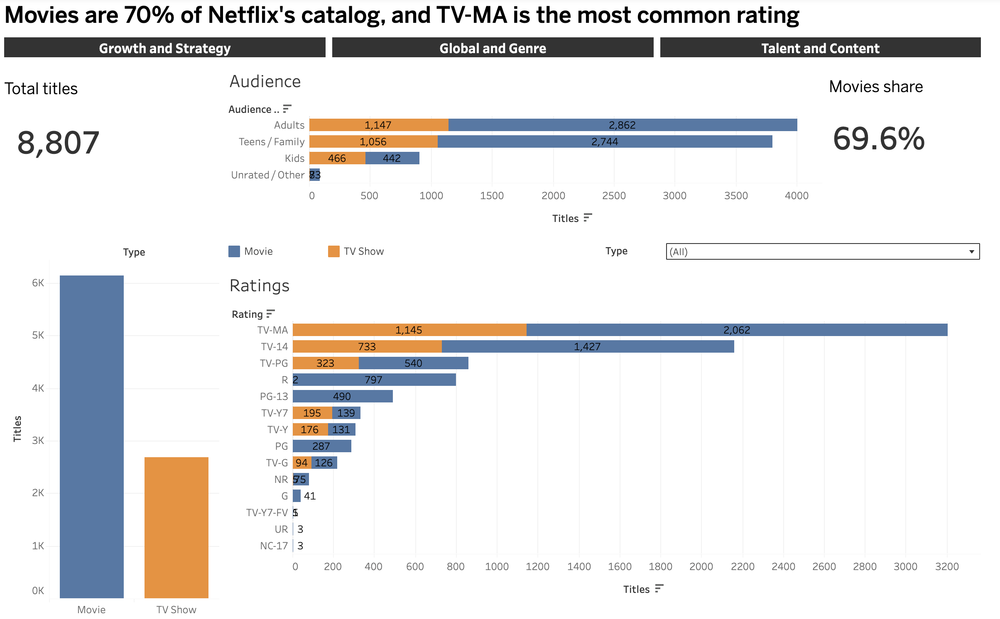

# Netflix Content Analysis (SQL + Tableau)

Analysis of 8,807 Netflix movies and TV shows. I answered 20 business questions in PostgreSQL and presented the results in 4 interactive Tableau dashboards.

**Live dashboards:** [Tableau Public](https://public.tableau.com/app/profile/tanish.rastogi/viz/NetflixContentAnalysis_/1_CatalogOverview)

## Tools

PostgreSQL (CTEs, window functions, CASE WHEN, UNNEST, views) and Tableau Public

## Dataset

[Netflix Movies and TV Shows](https://www.kaggle.com/datasets/shivamb/netflix-shows) on Kaggle (by Shivam Bansal). It covers titles added to Netflix through September 2021.

## Repository files

| File | What it contains |
|---|---|
| `NETFLIX_PROJECT.sql` | Table setup and the 20 business questions, each with its insight |
| `netflix_tableau_views.sql` | SQL views that prepare the data for Tableau |
| `netflix_titles.csv` | The original Kaggle dataset |
| `catalog_overview.png`, `growth&strategy.png`, `global&genre.png`, `talent&content.png` | Screenshots of the four dashboards |

## Key insights

- Movies are 69.6% of the catalog (6,131 titles) and TV shows 30.4% (2,676).
- TV-MA is the most common rating for both movies (2,062) and TV shows (1,145).
- Additions peaked in 2019 at 2,016 titles, and growth turned negative in 2020.
- TV's share of new titles rose from 25.0% in 2018 to 33.7% in 2021.
- The gap between a title's release and its arrival on Netflix grew from 1.3 years (2015) to 5.8 years (2021).
- The US leads with 3,690 titles, followed by India (1,046) and the UK (806).
- Dramas rank in the top 3 genres for all five of the top content-producing countries.
- About 91% of TV shows list no director, and 67% of TV shows have just one season.

## Dashboards

| Dashboard | What it shows | SQL problems |
|---|---|---|
| 1. Catalog Overview | Movies vs TV, ratings, audience groups | #1, #2 |
| 2. Growth and Strategy | Additions per year, YoY growth, movie/TV share, release gap | #16, #17, #18 |
| 3. Global and Genre | Countries, genres, India additions, genre-by-country heatmap | #4, #9, #10, #19 |
| 4. Talent and Content | Movie length, TV seasons, missing directors, top actors in India, directors by genres | #5, #8, #12, #14, #20 |

### 1. Catalog Overview


### 2. Growth and Strategy


### 3. Global and Genre


### 4. Talent and Content


## How to run the SQL

1. Create the `netflix` table with the `CREATE TABLE` statement below.
2. Import `netflix_titles.csv` into it.
3. Run the queries one at a time. `netflix_tableau_views.sql` creates the views used for Tableau.

---

## SQL queries (`NETFLIX_PROJECT.sql`)

### Setup

```sql
CREATE TABLE netflix
(
   show_id VARCHAR(6),
   type    VARCHAR(10),
   title   VARCHAR(150),
   director VARCHAR(208),
   casts 	    VARCHAR(1000),
   country  VARCHAR(150),
   date_added VARCHAR(50),
   release_year INT,
   rating VARCHAR(10),
   duration VARCHAR(15),
   listed_in VARCHAR(100),
   description VARCHAR(250)
);

SELECT * FROM netflix;

SELECT COUNT(*) as total_content
FROM netflix;
```

### Problem 1: Count the number of Movies vs TV Shows

```sql
SELECT
    type,COUNT(*) as total_content
FROM netflix
GROUP BY type;
```

**Insight:** Movies make up 69.6% of the catalog (6,131 titles) and TV Shows 30.4% (2,676).

### Problem 2: Find the most common rating for movies and TV shows

```sql
with tbl as (
SELECT
    type,
	rating,
	COUNT(*),
	RANK () OVER (PARTITION BY type ORDER BY COUNT(*) DESC) as ranking
FROM netflix
GROUP BY 1,2
ORDER BY 1,3 DESC
)
SELECT
    type,
	rating,
	count
FROM tbl
WHERE ranking=1;
```

**Insight:** TV-MA is the most common rating for both Movies (2,062) and TV Shows (1,145).

### Problem 3: List all movies released in a specific year (e.g., 2020)

```sql
SELECT
    title,release_year
FROM netflix
WHERE type = 'Movie' AND release_year=2020 ;
```

**Insight:** 517 movies were released in 2020.

### Problem 4: Find the top 5 countries with the most content on Netflix

```sql
SELECT
   TRIM(UNNEST(STRING_TO_ARRAY(country,','))) AS new_country,
   COUNT(show_id) as total_content
FROM netflix
GROUP BY new_country
ORDER BY total_content DESC
LIMIT 5;
```

**Insight:** The US has the most titles (3,690), followed by India (1,046), the UK (806), Canada (445) and France (393). Co-productions count toward each country involved.

### Problem 5: Identify the longest movie

```sql
SELECT title, duration
FROM netflix
WHERE type = 'Movie' AND duration IS NOT NULL
ORDER BY SPLIT_PART(duration, ' ', 1)::int DESC
LIMIT 1;
```

**Insight:** The longest movie is Black Mirror: Bandersnatch at 312 minutes.

### Problem 6: Find the content added in the last 8 years

```sql
SELECT *
FROM netflix
WHERE
    TO_DATE (date_added, 'Month DD,YYYY') >= CURRENT_DATE - INTERVAL '8 years' ;
```

**Insight:** 5,817 titles (about 66% of the catalog) were added in the last 8 years (as of run date). The dataset ends in September 2021, so this window only covers additions from October 2018 onward.

### Problem 7: Find all the movies/TV Shows by director 'Rajiv Chilaka'

```sql
SELECT
    *
FROM netflix
WHERE director ILIKE '%Rajiv Chilaka%';
```

**Insight:** Rajiv Chilaka has 22 titles on Netflix, all of them movies released between 2009 and 2019. Most are Chhota Bheem films.

### Problem 8: List all the TV Shows with more than 5 seasons

```sql
SELECT
    *
FROM netflix
WHERE
  type = 'TV Show'
  AND
  SPLIT_PART(duration, ' ',1)::numeric > 5 ;
```

**Insight:** Only 99 of 2,676 TV shows (3.7%) have more than 5 seasons. 67% of TV shows (1,793) have just one season.

### Problem 9: Count the number of content in each genre

```sql
SELECT
	 TRIM(UNNEST(STRING_TO_ARRAY(listed_in,','))) as genre,
	 COUNT(Show_id)
FROM netflix
GROUP BY 1 ;
```

**Insight:** The catalog spans 42 genres. International Movies (2,752), Dramas (2,427) and Comedies (1,674) are the biggest. A title can count toward several genres.

### Problem 10: For titles produced in only India, find the number of titles added each year and each year's share of India's total content. Return the year with the highest number of additions.

```sql
SELECT
    EXTRACT(YEAR FROM TO_DATE(TRIM(date_added), 'Month DD, YYYY'))::int AS year,
    COUNT(*) AS yearly_content,
    ROUND(COUNT(*)::numeric
          / (SELECT COUNT(*) FROM netflix WHERE country = 'India')::numeric * 100, 2)
          AS pct_of_india_content
FROM netflix
WHERE country = 'India'
GROUP BY 1
ORDER BY yearly_content DESC
LIMIT 1;
```

**Insight:** Among titles made only in India (972), 2018 had the most additions with 333 titles, 34.3% of the total. Additions then fell to 203 in 2019 and 189 in 2020. The percentage is each year's share of India's titles.

### Problem 11: List all movies that are documentaries

```sql
SELECT *
FROM netflix
WHERE
  type = 'Movie'
  AND
  listed_in ILIKE '%Documentaries%' ;
```

**Insight:** 869 movies are documentaries, about 9.9% of the catalog.

### Problem 12: Find all content without a director

```sql
SELECT *
FROM netflix
WHERE
  director IS NULL ;
```

**Insight:** 2,634 titles (29.9%) have no director listed. 2,446 of them are TV Shows, so about 91% of TV shows have no director, versus 188 missing among 6,131 movies.

### Problem 13: In how many movies/TV Shows has actor 'Salman Khan' appeared in the last 13 years?

```sql
SELECT * FROM netflix
WHERE
   casts ILIKE ('%Salman Khan%')
   AND
   release_year > EXTRACT(YEAR FROM CURRENT_DATE) - 13 ;
```

**Insight:** Salman Khan appears in 2 titles released in the last 13 years: Prem Ratan Dhan Payo (2015) and Paharganj (2019) (as on run date). He appears in 20 titles overall, and most were released before 2013.

### Problem 14: Find the top 10 actors who have appeared in the highest number of movies produced in India

```sql
SELECT
	TRIM(UNNEST(STRING_TO_ARRAY(casts, ','))) as actors,
	COUNT(*) as total_content
FROM netflix
WHERE country ILIKE '%India%'
GROUP BY 1
ORDER BY 2 DESC
LIMIT 10 ;
```

**Insight:** Anupam Kher appears in the most Indian titles (40), followed by Shah Rukh Khan (34) and Naseeruddin Shah (31). Akshay Kumar and Om Puri follow with 29 each. The top 10 runs down to Ajay Devgn with 21.

### Problem 15: Categorize the content based on the keywords 'kill' and 'violence' in the description. Label content containing these keywords as 'Bad' and all other content as 'Good'. Count how many items fall into each category.

```sql
SELECT
    CASE
        WHEN description ILIKE 'kill%'     OR description ILIKE '% kill%'
          OR description ILIKE 'violence%' OR description ILIKE '% violence%'
        THEN 'Bad_Content'
        ELSE 'Good_Content'
    END AS category,
    COUNT(*) AS total_content
FROM netflix
GROUP BY 1;
```

**Insight:** 272 titles (3.1%) mention "kill" or "violence" in the description, and 8,535 (96.9%) do not. It means the dataset is dominated by non-violent and good content. This is a rough keyword check, and the pattern only matches at the start of a word so that words like "skill" are not flagged.

### Problem 16: How many titles were added per year, and what is the year-over-year growth percentage?

```sql
WITH tbl AS (
  SELECT EXTRACT(YEAR FROM TO_DATE(TRIM(date_added), 'Month DD, YYYY'))::int AS year_added,
         COUNT(*) AS titles
  FROM netflix
  WHERE date_added IS NOT NULL
  GROUP BY 1
)
SELECT year_added, titles,
       ROUND(100.0 * (titles - LAG(titles) OVER (ORDER BY year_added))
             / NULLIF(LAG(titles) OVER (ORDER BY year_added), 0), 1) AS yoy_growth_pct
FROM tbl
ORDER BY year_added;
```

**Insight:** Additions exploded between 2015 and 2017 and peaked in 2019 at 2,016 titles. Growth then slowed sharply (from +176.9% in 2017 to +22.3% in 2019) and turned negative in 2020. 2021 is a partial year.

### Problem 17: For each year, what share of newly added content is Movies vs. TV Shows?

```sql
SELECT EXTRACT(YEAR FROM TO_DATE(TRIM(date_added), 'Month DD, YYYY'))::int AS year_added,
       COUNT(*) AS total,
       ROUND(100.0 * SUM(CASE WHEN type = 'Movie' THEN 1 ELSE 0 END) / COUNT(*), 1) AS movie_pct,
       ROUND(100.0 * SUM(CASE WHEN type = 'TV Show' THEN 1 ELSE 0 END) / COUNT(*), 1) AS tv_pct
FROM netflix
WHERE date_added IS NOT NULL
GROUP BY 1
ORDER BY 1;
```

**Insight:** Movies are 69.6% of the catalog (6,131 movies vs. 2,676 TV shows). Movie share peaked at 75.0% in 2018, then fell each year, while TV share rose from 25.0% to 33.7% by 2021. This points to a gradual rebalancing toward series content, which typically keeps viewers subscribed longer. Years before 2016 have too few titles to draw conclusions from.

### Problem 18: What is the average gap between release_year and the year a title was added to Netflix? Has it shrunk over time?

```sql
SELECT year_added,
       ROUND(AVG(year_added - release_year), 1) AS avg_gap_years
FROM (
  SELECT EXTRACT(YEAR FROM TO_DATE(TRIM(date_added), 'Month DD, YYYY'))::int AS year_added,
         release_year
  FROM netflix
  WHERE date_added IS NOT NULL
)
GROUP BY year_added
ORDER BY year_added;
```

**Insight:** The average gap between a title's release and its arrival on Netflix grew from 1.3 years (2015) to 5.8 years (2021), with an overall average of 4.69 years. Titles added in later years were, on average, older when they arrived.

### Problem 19: What are the top 3 genres in each of the top 5 content-producing countries?

```sql
WITH exploded AS (
  SELECT show_id, TRIM(c) AS country, TRIM(g) AS genre
  FROM netflix,
       UNNEST(STRING_TO_ARRAY(country, ',')) AS c,
       UNNEST(STRING_TO_ARRAY(listed_in, ',')) AS g
  WHERE country IS NOT NULL AND TRIM(c) <> ''
),
top5 AS (
  SELECT country,
         COUNT(DISTINCT show_id) AS total_titles,
         ROW_NUMBER() OVER (ORDER BY COUNT(DISTINCT show_id) DESC) AS country_rank
  FROM exploded
  GROUP BY country
  ORDER BY total_titles DESC
  LIMIT 5
),
ranked AS (
  SELECT e.country, t.country_rank, t.total_titles, e.genre,
         COUNT(*) AS cnt,
         DENSE_RANK() OVER (PARTITION BY e.country ORDER BY COUNT(*) DESC) AS genre_rank
  FROM exploded e
  JOIN top5 t ON e.country = t.country
  GROUP BY e.country, t.country_rank, t.total_titles, e.genre
)
SELECT country_rank, country, total_titles, genre_rank, genre, cnt
FROM ranked
WHERE genre_rank <= 3
ORDER BY country_rank, genre_rank;
```

**Insight:** The US has more than three times the titles of second-place India, and leans on dramas, comedies and documentaries. India is dominated by international movies and dramas, while Canada stands out for children and family content. Dramas appear in the top 3 for all five countries, making it the most universal genre.

### Problem 20: Which directors have worked across the most distinct genres?

```sql
WITH tbl AS (
  SELECT TRIM(dir) AS director, TRIM(g) AS genre
  FROM netflix,
       UNNEST(STRING_TO_ARRAY(director, ',')) AS dir,
       UNNEST(STRING_TO_ARRAY(listed_in, ',')) AS g
  WHERE director IS NOT NULL
)
SELECT director, COUNT(DISTINCT genre) AS genres_covered
FROM tbl
GROUP BY director
ORDER BY genres_covered DESC
LIMIT 10;
```

**Insight:** Martin Scorsese and Anurag Kashyap have worked in the most genres, 9 each. Five more directors have worked in 8 genres. Five of the top seven directors are Indian. This only counts titles that list a director, which is about 70% of the catalog.

---

## SQL views for Tableau (`netflix_tableau_views.sql`)

Columns such as country, genre, cast and director hold several comma-separated values in one cell. These views split them into one row per value so Tableau can count them properly.

### View 1: Main table, one row per title

```sql
CREATE OR REPLACE VIEW netflix_clean AS
SELECT show_id, type, title, release_year, description,
       CASE WHEN rating ILIKE '%min' THEN NULL ELSE rating END AS rating,
       TO_DATE(TRIM(date_added), 'Month DD, YYYY') AS date_added,
       EXTRACT(YEAR FROM TO_DATE(TRIM(date_added), 'Month DD, YYYY'))::int AS year_added,
       CASE WHEN type = 'Movie' AND COALESCE(duration, rating) ~ '^[0-9]+ min'
            THEN SPLIT_PART(COALESCE(duration, rating), ' ', 1)::int END AS minutes,
       CASE WHEN type = 'TV Show' THEN SPLIT_PART(duration, ' ', 1)::int END AS seasons,
       (director IS NOT NULL) AS has_director
FROM netflix;
```

### View 2: One row per title per country

```sql
CREATE OR REPLACE VIEW netflix_country AS
SELECT show_id, TRIM(UNNEST(STRING_TO_ARRAY(country, ','))) AS country
FROM netflix WHERE country IS NOT NULL;
```

### View 3: One row per title per genre

```sql
CREATE OR REPLACE VIEW netflix_genre AS
SELECT show_id, TRIM(UNNEST(STRING_TO_ARRAY(listed_in, ','))) AS genre
FROM netflix;
```

### View 4: One row per title per actor

```sql
CREATE OR REPLACE VIEW netflix_cast AS
SELECT show_id, TRIM(UNNEST(STRING_TO_ARRAY(casts, ','))) AS actor
FROM netflix WHERE casts IS NOT NULL;
```

### View 5: One row per title per director

```sql
CREATE OR REPLACE VIEW netflix_director AS
SELECT show_id, TRIM(UNNEST(STRING_TO_ARRAY(director, ','))) AS director
FROM netflix WHERE director IS NOT NULL;
```

### Checking that the views work

```sql
SELECT * FROM netflix_clean LIMIT 10;
SELECT COUNT(*) FROM netflix_clean;
SELECT COUNT(*) FROM netflix_clean WHERE minutes IS NULL AND type='Movie';
SELECT * FROM netflix_genre LIMIT 10;
SELECT * FROM netflix_director;
```

---

## Notes

- 2021 is a partial year (data through September 2021).
- Titles with several countries or genres count toward each one.
- Genre counts in the Tableau dashboards exclude the 831 titles with no listed country, so they are lower than the SQL counts (for example, International Movies is 2,543 in Tableau and 2,752 in SQL).
- Queries 6 and 13 use today's date, so their results change over time.
- Query 15 is a rough keyword check on descriptions, not a content rating.
- Director charts include only titles that list a director (about 70% of the catalog).

## Author

Tanish Rastogi
